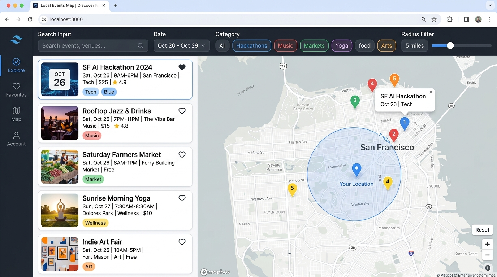

# 📍 Local Events India - Interactive Map & Discovery

> 🌐 **Live Demo**: [https://local-events-map.onrender.com](https://local-events-map.onrender.com)

[](https://render.com/deploy?repo=https://github.com/dipanr705-12/local-events-map)

A modern, responsive web application for discovering and sharing local events happening across India. Explore events on an interactive map or a searchable list, filter by top Indian cities (Bengaluru, Mumbai, Delhi NCR, Hyderabad, Pune, Kolkata, Chennai, Goa, Jaipur), categories, date, and distance, save your favorite events, and host new events.



---

## ✨ Features

- **🔱 Complete West Bengal Durga Puja Pandals Directory**:
  - Over 42 world-famous pandals across Kolkata (North, Central, South, Salt Lake, VIP Road) and districts (Nadia Kalyani, North 24 Pgs Barasat, Hooghly Chandannagar, Howrah, Siliguri, Bardhaman).
  - Accurate GPS coordinates, nearest metro/railway stations, optimal visiting hours, themes, and 1-click turn-by-turn navigation.
  - Dedicated **Durga Puja Pandal** category filter and custom map pins.
- **🗺️ Interactive Map & List Synchronization**:
  - Live map powered by Leaflet & OpenStreetMap tiles (no API keys required).
  - Color-coded pins for each category (Tech & AI, Music, Food, Arts, Sports, Community, Outdoors).
  - Hovering or clicking an event card highlights and centers its pin on the map.
  - Clicking any pin opens a preview popup with one-click access to detailed view.
- **🔍 Rich Filtering & Search**:
  - Full-text search across titles, descriptions, venues, and addresses.
  - Category filter pills with dynamic event counts.
  - Date shortcuts: *Any Date*, *Today*, *Tomorrow*, *This Weekend*, *Next 7 Days*.
  - Distance radius filtering: *5 km*, *10 km*, *25 km*, *50 km* relative to your location.
  - Visual radius circle rendered directly onto the map.
- **📍 "Near Me" Geolocation**:
  - One-click browser geolocation to center the search on your exact location.
  - Pulsing radar marker for user location.
- **âž• Host & Share Events**:
  - Form with real-time validation for required fields, coordinates, and date/time.
  - **Interactive location picker**: Click directly on the mini-map or drag the marker to pinpoint the exact venue location.
  - Integrated address search/geocoding using OpenStreetMap Nominatim.
  - 1-click preset cover image selector for easy publishing.
- **❤️ Saved Favorites**:
  - Save events to your personal favorites list with instant persistence in `localStorage`.
  - Filter view to display only your saved favorites.
- **🗓️ Event Details & Actions**:
  - Add to Google Calendar with pre-populated event details.
  - Turn-by-turn driving and transit directions link.
  - Share event link or copy to clipboard.
- **📱 Responsive Layout**:
  - Desktop: 2-column split-view (scrollable event feed on the left, sticky interactive map on the right).
  - Mobile: Clean toggle between Map View and List View.

---

## 🛠️ Technology Stack

| Layer | Technology | Rationale |
|---|---|---|
| **Frontend** | React 19 + Vite | Ultra-fast HMR and build speeds, component modularity |
| **Styling** | Tailwind CSS v4 | Clean utility classes, accessible responsive design |
| **Mapping** | Leaflet + OpenStreetMap | Works out-of-the-box without requiring third-party API keys or credit cards |
| **Icons** | Lucide React | Clean, consistent icons |
| **Backend API** | Node.js + Express | Lightweight, reliable REST API |
| **Database** | Native SQLite (`node:sqlite`) | Built into Node 22+, zero external C++ build tool dependencies on Windows/Mac/Linux |
| **Testing** | Node Native Test Runner (`node:test`) | Instant test execution without extra test runner bloat |

---

## 🚀 Quick Start

### Prerequisites
- Node.js `v22.5.0` or higher (tested on Node v24)
- npm `v10+`

### 1. Clone & Navigate
```bash
git clone https://github.com/dipanr705-12/local-events-map.git
cd local-events-map
```

### 2. Install Dependencies
Install dependencies for both server and client:
```bash
# Server
cd server
npm install

# Client
cd ../client
npm install
```

### 3. Seed Database
Populate the SQLite database with 12 realistic upcoming sample events:
```bash
cd server
npm run seed
```

### 4. Start Development Servers
Run the backend and frontend in separate terminals:

**Terminal 1 (Backend API):**
```bash
cd server
npm start
# Server starts on http://localhost:5000
```

**Terminal 2 (Frontend Client):**
```bash
cd client
npm run dev
# Vite starts on http://localhost:5173
```

Open your browser at **`http://localhost:5173`** to explore the application!

---

## 🧪 Running Tests

The test suite validates event payload sanitization, field validation rules, coordinate boundary constraints, and Haversine distance calculations:

```bash
cd server
npm test
```

### Test Coverage Highlights:
- ✅ Event validation (missing fields, short titles, invalid categories)
- ✅ Geographic coordinate validation (bounds checking: lat -90..90, lng -180..180)
- ✅ Haversine distance calculations (calculates accurate kilometer distances between coordinates)
- ✅ Date range filtering logic (today, tomorrow, weekend, week)

---

## 🗺️ Map Configuration & Environment Variables

By default, the app uses **OpenStreetMap** raster tiles which require **no API key**.

If you wish to use custom tiles (e.g. Mapbox or CartoDB), update `server/.env`:

```env
PORT=5000
CORS_ORIGIN=http://localhost:5173
DB_PATH=./data/events.db

# OpenStreetMap (Default - Free, no key required):
MAP_TILE_URL=https://{s}.tile.openstreetmap.org/{z}/{x}/{y}.png
MAP_ATTRIBUTION=&copy; <a href="https://www.openstreetmap.org/copyright">OpenStreetMap</a> contributors

# Optional CartoDB Voyager Tile Style:
# MAP_TILE_URL=https://{s}.basemaps.cartocdn.com/rastertiles/voyager/{z}/{x}/{y}{r}.png

# Optional Mapbox Custom Style:
# MAP_TILE_URL=https://api.mapbox.com/styles/v1/{username}/{style_id}/tiles/{z}/{x}/{y}?access_token={YOUR_TOKEN}
```

The frontend fetches this configuration dynamically via `GET /api/config`.

---

## 📡 API Endpoints

| Method | Endpoint | Description |
|---|---|---|
| `GET` | `/api/health` | Service health status |
| `GET` | `/api/config` | Map tile configuration and default coordinates |
| `GET` | `/api/categories` | Categories list with active event counts |
| `GET` | `/api/events` | List events with filters (`search`, `category`, `dateRange`, `lat`, `lng`, `radius`, `sortBy`, `favorites`) |
| `GET` | `/api/events/:id` | Fetch single event details |
| `POST` | `/api/events` | Create new event (validated payload) |
| `PUT` | `/api/events/:id` | Update an existing event |
| `DELETE`| `/api/events/:id` | Delete event |
| `POST` | `/api/seed` | Reset/re-seed database with sample events |
| `GET` | `/api/geocode?q=...` | Geocoding proxy for address searches |

---

## 📁 Project Structure

```
local-events-map/
├── client/                      # Frontend Application (React + Vite + Tailwind)
│   ├── src/
│   │   ├── components/
│   │   │   ├── AddEventModal.jsx    # Event creation form with mini-map location picker
│   │   │   ├── EmptyState.jsx      # No-results & no-favorites states
│   │   │   ├── EventCard.jsx       # Event card with category badges & hover sync
│   │   │   ├── EventModal.jsx      # Full details, directions, & Google Calendar
│   │   │   ├── FilterBar.jsx       # Search, category pills, date, & distance filters
│   │   │   ├── LoadingSkeleton.jsx # Pulse skeleton for loading states
│   │   │   ├── MapView.jsx         # Leaflet interactive map with custom pins & radius
│   │   │   └── Navbar.jsx          # Header with mobile view switcher & favorites count
│   │   ├── utils/
│   │   │   ├── api.js              # Fetch client for backend endpoints
│   │   │   └── constants.js        # Category definitions, colors, preset images
│   │   ├── App.jsx                 # App root & state management
│   │   ├── index.css               # Tailwind CSS & custom pin styles
│   │   └── main.jsx
│   ├── vite.config.js              # Vite config with API proxy
│   └── package.json
│
├── server/                      # Backend API (Express + SQLite)
│   ├── src/
│   │   ├── db.js                   # SQLite connection & schema (node:sqlite)
│   │   ├── index.js                # Express REST API routes
│   │   ├── seed.js                 # Sample event seed data
│   │   ├── utils.js                # Haversine distance & date range calculations
│   │   └── validation.js           # Server-side input validation
│   ├── tests/
│   │   └── api.test.js             # Automated unit & integration tests
│   ├── .env.example
│   └── package.json
│
├── docs/
│   └── screenshot.jpg          # Application screenshot
├── .env.example
├── package.json
└── README.md
```

---

## ☁️ Deploy to Render (Free Permanent Hosting)

This project includes a [`render.yaml`](./render.yaml) for one-click deployment on [Render](https://render.com).

**Steps:**
1. Fork this repo on GitHub.
2. Go to [render.com](https://render.com) → **New** → **Blueprint**.
3. Connect your GitHub and select your fork.
4. Render will auto-detect `render.yaml` and deploy the app.
5. Your live URL will be: `https://local-events-map.onrender.com`

> **Note:** The free Render tier spins down after 15 minutes of inactivity. First request may take ~30 seconds to wake up. The SQLite database is persisted on a 1 GB disk.

---

## 📄 License
MIT
